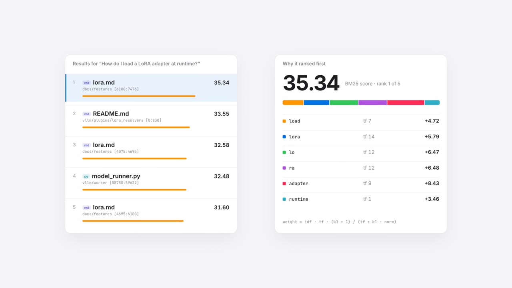

*This project has been created as part of the 42 curriculum by dbaltaza.*

# RAG against the machine

## Description

A Retrieval-Augmented Generation (RAG) system that answers questions about
the [vLLM 0.10.1](https://github.com/vllm-project/vllm) codebase.

The pipeline has four stages:

1. **Index**: walk `data/raw/`, split every Python and Markdown/text file into
   chunks of at most 2000 characters, and persist a BM25 index under
   `data/processed/`.
2. **Retrieve**: score every chunk against a question with BM25 and return
   the top-k source locations (file path + character span).
3. **Augment**: place the retrieved chunks, in rank order, inside the prompt
   of a small local language model within a token budget.
4. **Generate**: `Qwen/Qwen3-0.6B` writes an answer grounded in that context.

Retrieval quality is measured with recall@k against the reference datasets.
On the public datasets the system reaches **0.88 recall@5 on docs** and
**0.85 recall@5 on code** (thresholds: 0.80 and 0.50).

### The project in 60 seconds

[](media/rag-against-the-machine.mp4)

[Watch the film](media/rag-against-the-machine.mp4) (60 s, 1080p). It is
made in code: `media/video/demo.html` draws every frame from a time value
(open it in a browser to scrub it) and `media/video/render.mjs` renders it to
MP4 with Playwright and ffmpeg. Every number in it is a real measurement from
this repository.

## Instructions

### Requirements

- Python 3.10+ and [uv](https://docs.astral.sh/uv/).
- ~3 GB of free disk space for the deep-learning stack and model weights.
- The vLLM repository under `data/raw/vllm-0.10.1/` and the datasets under
  `data/datasets/{UnansweredQuestions,AnsweredQuestions}/`.

### Installation

```sh
make install            # uv sync
# optional, for the semantic / hybrid retrieval bonus:
uv sync --extra semantic
```

### Makefile targets

| Target | What it does |
|--------|--------------|
| `make install` | `uv sync` |
| `make run` | Runs `python -m src` (prints the command list) |
| `make debug` | Runs the `index` command under `pdb` |
| `make lint` | `flake8 .` + `mypy .` with the mandatory flags |
| `make lint-strict` | `flake8 .` + `mypy . --strict` |
| `make test` | `pytest` |
| `make clean` | Removes `__pycache__`, `.mypy_cache`, `.pytest_cache` |
| `make index` / `make search-dataset` / `make evaluate` / `make answer-dataset` | Shortcuts for the pipeline (see variables at the top of the Makefile) |

### Command-line interface

Every command runs as `uv run python -m src <command> [options]`.

| Command | Options | Purpose |
|---------|---------|---------|
| `index` | `--max_chunk_size <int>` (default 2000), `--incremental`, `--semantic` | Ingest `data/raw/` and write the index to `data/processed/` |
| `search <query>` | `--k <int>`, `--mode lexical\|semantic\|hybrid`, `--as_json` | Top-k sources for one query |
| `search_dataset` | `--dataset_path`, `--k`, `--save_directory`, `--mode` | Search a whole dataset, write a `StudentSearchResults` JSON |
| `answer <query>` | `--k <int>`, `--mode`, `--as_json` | Retrieve and answer one query |
| `answer_dataset` | `--student_search_results_path`, `--save_directory`, `--max_sources` | Answer every question of a results file, write a `StudentSearchResultsAndAnswer` JSON |
| `evaluate` | `--student_search_results_path`, `--dataset_path`, `--max_context_length` | Recall@1/3/5/10 against a ground-truth dataset |
| `serve` | `--host`, `--port` | Local HTTP API (bonus) |
| `clear_cache` | | Drop the on-disk query cache (bonus) |

Global options go before the command and select the directories:
`--raw_directory`, `--processed_directory`, `--cache_directory`,
`--use_cache`, `--model_name`.

Output files are named after the input file and written into
`--save_directory`, so scope that directory by dataset
(`UnansweredQuestions` or `AnsweredQuestions`) to avoid overwriting runs.

## Example usage

```sh
# 1. Index the corpus (about 5 seconds)
uv run python -m src index --max_chunk_size 2000

# 2. Search one question
uv run python -m src search "How do I dynamically load a LoRA adapter?" --k 3

# 3. Search a whole dataset
uv run python -m src search_dataset \
  --dataset_path data/datasets/UnansweredQuestions/dataset_docs_public.json \
  --k 10 \
  --save_directory data/output/search_results/UnansweredQuestions

# 4. Measure recall@k (same rules as the moulinette)
uv run python -m src evaluate \
  --student_search_results_path data/output/search_results/UnansweredQuestions/dataset_docs_public.json \
  --dataset_path data/datasets/AnsweredQuestions/dataset_docs_public.json

# 5. Generate answers
uv run python -m src answer_dataset \
  --student_search_results_path data/output/search_results/UnansweredQuestions/dataset_docs_public.json \
  --save_directory data/output/search_results_and_answer/UnansweredQuestions

# 6. Answer a single question
uv run python -m src answer "What HTTP endpoint loads a LoRA adapter?" --k 5
```

Output of step 6:

```
Sources:
 1. data/raw/vllm-0.10.1/docs/features/lora.md [4695:6100]
 2. data/raw/vllm-0.10.1/docs/features/lora.md [4075:4695]
 ...
Answer:
The HTTP endpoint used to dynamically load a LoRA adapter in vLLM is `/v1/load_lora_adapter`.
```

With the official moulinette (Linux binary, run from the repository root):

```sh
./moulinette/moulinette evaluate_student_search_results \
  data/output/search_results/UnansweredQuestions/dataset_docs_public.json \
  data/datasets/AnsweredQuestions/dataset_docs_public.json \
  --k 10 --max_context_length 2000
```

## System architecture

```
src/
├── __main__.py        entry point: fire.Fire(RagCli) + clean error handling
├── cli.py             RagCli: argument validation, printing
├── pipeline.py        RagPipeline: orchestrates the stages below
├── models.py          pydantic models (subject models + Chunk, ScoredSource, ...)
├── tokenizer.py       lexical tokenizer (identifier splitting, stop words)
├── chunking/
│   ├── python.py      AST-based chunking of .py files
│   ├── markdown.py    heading/paragraph chunking of .md / .txt files
│   └── base.py        line splitting, span packing, strategy selection
├── index/
│   ├── indexer.py     corpus walk, chunking, full and incremental builds
│   ├── bm25.py        sparse term-frequency matrix -> BM25 weights
│   ├── store.py       persistence under data/processed/
│   └── semantic.py    MiniLM embeddings (bonus)
├── retrieval/
│   └── retriever.py   lexical / semantic / hybrid (RRF) search
├── generation/
│   └── generator.py   Qwen3-0.6B prompt building and decoding
├── evaluation.py      recall@k with the IoU >= 0.05 rule
├── cache.py           on-disk query cache (bonus)
├── io_utils.py        JSON loading with distinct error messages
└── api.py             FastAPI app (bonus)
```

Data flow:

```
data/raw/**/*.{py,md,txt}
   │  Indexer.corpus_files()          skips tests/, benchmarks/, .git, ...
   ▼
chunk_file()  ── python.py / markdown.py ──►  List[Chunk]
   │  index_text_for(): "<relative path> x2 + chunk text"
   ▼
term_frequency_matrix()  ──►  CSR (chunks x vocabulary), vocabulary.json
   │  persisted as chunks.jsonl, term_frequencies.npz, vocabulary.json, manifest.json
   ▼
Retriever ── BM25Index.scores(query) ──► top-k ScoredSource
   │
   ▼
Generator.build_prompt()  ──►  Qwen3-0.6B  ──►  MinimalAnswer
```

The pydantic models from the subject (`MinimalSource`, `UnansweredQuestion`,
`AnsweredQuestion`, `RagDataset`, `MinimalSearchResults`, `MinimalAnswer`,
`StudentSearchResults`, `StudentSearchResultsAndAnswer`) validate every file
read or written. Internal models (`Chunk`, `ScoredSource`, `IndexManifest`)
extend them.

## Chunking strategy

Two strategies, chosen by file extension, both producing spans that cover the
file completely and never exceed `--max_chunk_size`:

**Python (`chunking/python.py`)**: the file is parsed with `ast`. Each
top-level statement ends a chunk boundary, and a boundary is the *end* of the
previous statement, so comments and decorators before a `def` stay attached
to it. Classes larger than the limit are cut on their methods. Anything still
too large (a giant function, a long literal) is cut on line boundaries, and a
single line longer than the limit is cut at character granularity. Files that
do not parse fall back to line splitting. Small neighbours (imports, constants)
are merged up to `min_chunk_size` (800 characters) to reduce noise.

**Markdown / text (`chunking/markdown.py`)**: the file is cut on headings
(`#` to `######`) that are *outside* fenced code blocks, so a chunk is one
section: heading plus body. Oversized sections are cut on blank lines with
fenced code blocks kept whole, and then packed back up to the limit. Plain
text files (`CMakeLists.txt`, ...) have no headings and go straight to the
paragraph splitter.

The indexed text of a chunk is the chunk plus its relative file path
(repeated twice), so a question that names a module or a page
(`triton_flash_attention`, `lora`) matches every chunk of that file.

## Retrieval method

**Tokenizer**: lowercase word tokens; identifiers are kept whole *and* split
on `snake_case` / `camelCase` (`FusedMoEActivationFormat` -> whole token +
`fused`, `mo`, `e`, `activation`, `format`); a small stop-word list; trailing
plural `s` stripped. The same tokenizer is applied to queries, so a question
can match either a paraphrase ("fused batched MoE layer") or a verbatim
identifier.

**BM25** (`index/bm25.py`), `k1 = 1.5`, `b = 0.75`: the index stores a sparse
term-frequency matrix (scipy CSR). BM25 weights are derived at load time:

```
idf(t)   = ln((N - df + 0.5) / (df + 0.5) + 1)
w(d, t)  = idf(t) * tf * (k1 + 1) / (tf + k1 * (1 - b + b * |d| / avgdl))
```

A query sums the weight columns of its terms (times the query term count)
and `argpartition` picks the top-k. Zero-score documents are never returned,
so a nonsensical query yields an empty list. The result is the chunk span
converted to a `MinimalSource`; file paths are the corpus paths verbatim
(`data/raw/vllm-0.10.1/...`).

Bonus modes: `--mode semantic` ranks by cosine similarity of
`all-MiniLM-L6-v2` embeddings; `--mode hybrid` fuses the BM25 and semantic
rankings with reciprocal rank fusion (`1 / (60 + rank)`).

## Performance analysis

Measured on an Apple Silicon laptop with the public datasets, `k = 10`,
`max_chunk_size = 2000`:

| Dataset | Recall@1 | Recall@3 | Recall@5 | Recall@10 | Threshold@5 |
|---------|---------:|---------:|---------:|----------:|------------:|
| docs (100 q) | 0.680 | 0.830 | **0.880** | 0.910 | 0.80 |
| code (99 q)  | 0.545 | 0.758 | **0.848** | 0.899 | 0.50 |

| Metric | Value | Limit |
|--------|------:|------:|
| Indexing (1179 files, 11 582 chunks) | ~4.5 s | 5 min |
| Indexing with semantic embeddings | ~85 s | 5 min |
| Index load | ~0.1 s | |
| Retrieval, 199 questions | ~0.1 s | 90 s for 200 |
| Answer generation (Qwen3-0.6B, 5 sources, MPS) | ~4 s / question (100 docs questions in 6 min 14 s) | |

Effect of the parameters (recall@5, docs / code):

| Setting | docs | code |
|---------|-----:|-----:|
| no neighbour merging (`min_chunk_size = 0`) | 0.86 | 0.78 |
| merge up to 400 chars | 0.86 | 0.83 |
| **merge up to 800 chars (default)** | **0.88** | **0.85** |
| merge up to 1200 chars | 0.88 | 0.84 |
| no file path in the indexed text | 0.84 | 0.72 |
| file path once | 0.86 | 0.82 |
| **file path twice (default)** | **0.88** | **0.85** |
| semantic only (MiniLM) | 0.66 | 0.58 |
| hybrid (RRF of BM25 + MiniLM) | 0.85 | 0.79 |

Smaller chunks keep the IoU with the reference span high but split the
vocabulary of a function across several documents, which hurts BM25.
Merging tiny neighbours (import blocks, one-line constants) into
~800-character chunks was the best trade-off; going further starts to lower
the IoU with short reference spans (the smallest reference span is 12
characters).

The prefix trick (path repeated twice) is the single biggest win on code
questions (+13 points): many questions name the module they ask about.

## Design decisions

- **BM25 over TF-IDF**: length normalisation matters when chunks range from
  a few dozen to 2000 characters, and BM25's saturation stops a chunk full of
  the same identifier from dominating.
- **Own sparse implementation**: a CSR term-frequency matrix is ~1.5 MB on
  disk, loads in 0.1 s, and weight computation is a few numpy operations.
  Storing counts rather than weights also makes incremental indexing a row
  replacement.
- **Spans, not text, are the contract**: results carry only file path and
  character offsets; `answer_dataset` re-reads the text from disk, so it
  works on any results file, even one produced by another retriever.
- **Lazy loading**: the language model is only loaded by `answer` /
  `answer_dataset`; every retrieval command runs without torch models.
- **Prompting**: thinking is disabled (`enable_thinking=False`); sources are
  numbered with their path and inserted in rank order until a 3000-token
  budget is reached; the system prompt asks the model to quote identifiers
  verbatim and to say when the context does not contain the answer; greedy
  decoding with a mild repetition penalty.
- **Robustness**: every input file goes through `io_utils.load_model`, which
  gives distinct messages for a missing file, a directory, non-UTF-8 content,
  an empty file, invalid JSON and a schema mismatch. `__main__` converts any
  exception into `Error: ...` on stderr with exit code 1; empty queries,
  `k = 0`, unknown modes, `--k abc` and `--max_chunk_size 5000` are rejected
  or produce an empty result, never a traceback.
- **Excluded directories**: `tests/`, `benchmarks/`, `.buildkite/` and
  `.github/` are skipped; they double the corpus and only add near-duplicate
  identifiers that push the real implementation down the ranking.

## Challenges faced

- **Paraphrase vs identifier**: a question says "fused batched MoE layer",
  the code says `FusedBatchedExperts`. Keeping identifiers both whole and
  split into parts, at index and query time, solved most misses.
- **Character offsets**: the reference spans are Python string indices on
  UTF-8 decoded text, so every chunk is a slice `text[start:end]` and the
  tests assert that the slice equals the chunk text. Line-based cuts had to
  keep the trailing newline on the right side to avoid off-by-one gaps.
- **Headings inside code blocks**: a `# comment` inside a fenced bash block
  looks like a Markdown heading. The Markdown chunker tracks fences.
- **Empty or odd Python files**: modules containing only comments have an
  empty AST body; the first version of the chunker crashed on them. The
  boundary logic now pairs each span with its node explicitly.
- **Small-model answers**: Qwen3-0.6B tends to think aloud and to repeat the
  question. Disabling thinking, stripping `<think>` blocks defensively and
  limiting the context to the top sources gives short, mostly grounded
  answers.
- **The moulinette is a Linux binary**: it does not run on macOS, so the
  `evaluate` command re-implements its rules (same file, IoU >= 0.05, mean
  over questions, validity checks on width and count) for local iteration.

## Bonus

All five bonuses are implemented:

1. **Semantic embeddings**: `index --semantic True` embeds every chunk with
   `sentence-transformers/all-MiniLM-L6-v2` (`data/processed/embeddings.npy`);
   `search --mode semantic`. Requires `uv sync --extra semantic`.
2. **Hybrid retrieval**: `search --mode hybrid` merges BM25 and semantic
   rankings with reciprocal rank fusion.
3. **Incremental indexing**: `index --incremental True` hashes every file,
   re-chunks only new or modified files, drops deleted ones, and stacks the
   kept term-frequency rows with the new ones.
4. **Caching**: query results are cached in `data/cache/queries.json`, keyed
   by query, k, mode and an index fingerprint (cleared on every rebuild);
   `clear_cache` empties it, `--use_cache False` disables it.
5. **Local HTTP API**: `serve --port 8000` (or `make serve`) starts a
   FastAPI app with `GET /health`, `GET /modes`, `POST /search` and
   `POST /answer` (`{"query": "...", "k": 5, "mode": "lexical"}`).

## Workbench (extra)

`workbench/` is a study and debugging tool built on top of the pipeline. It is
not part of the subject, and nothing in `src/` imports it.

```sh
make workbench        # or: uv run python -m workbench --port 8000
```

Then open <http://127.0.0.1:8000>. It has two parts:

- **Guide**: one chapter per pipeline stage (chunking, tokenizing, BM25,
  prompt building, generation, recall). Each chapter explains what the code
  does and runs it live on the real index: chunk any corpus file with custom
  sizes, tokenize any text, see a BM25 score split by term with the formula
  filled in, read the exact prompt Qwen3 receives, and drag two spans to see
  when the IoU passes 0.05.
- **Workbench**: query bar, ranked results, the source file with the
  retrieved span highlighted, and an inspector with the BM25 breakdown, the
  answer, the prompt and the chunk metadata. A dataset mode runs the public
  questions and shows which ones are missed, with their reference sources
  marked in the file.

Layout: `workbench/server.py` (FastAPI endpoints), `workbench/learn.py`
(stage-by-stage explanations computed with the project's own code) and
`workbench/web/` (the page: plain HTML, CSS and JavaScript, no external
assets).

## Resources

- Robertson & Zaragoza, *The Probabilistic Relevance Framework: BM25 and
  Beyond* (2009).
- Lewis et al., *Retrieval-Augmented Generation for Knowledge-Intensive NLP
  Tasks* (2020).
- Cormack et al., *Reciprocal Rank Fusion outperforms Condorcet and
  individual Rank Learning Methods* (2009).
- [Qwen3 model card](https://huggingface.co/Qwen/Qwen3-0.6B) and the
  Transformers chat-template documentation.
- [Sentence-Transformers documentation](https://www.sbert.net/).
- [Python Fire](https://google.github.io/python-fire/),
  [pydantic](https://docs.pydantic.dev/), [uv](https://docs.astral.sh/uv/).

### How AI was used

Claude (Anthropic) was used as a pair programmer for this project:
scaffolding the module layout, writing the first version of the chunkers,
the sparse BM25 implementation and the CLI, generating the pytest suite, and
drafting this README. Every generated part was run against the public
datasets, the parameter sweep in the performance section was executed to
choose the defaults, and the edge-case behaviour of the CLI was checked by
hand. The retrieval design (identifier splitting, path prefixing, statement
boundary chunking) was iterated from measured recall, not taken as-is.
